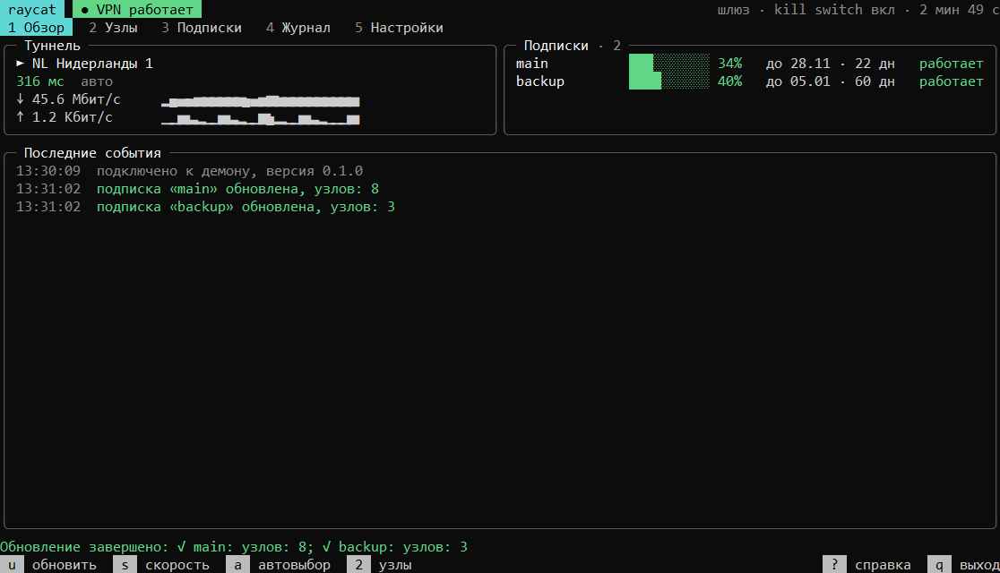
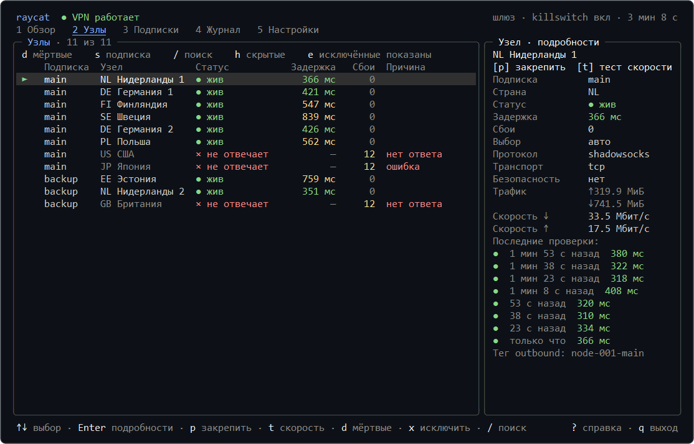
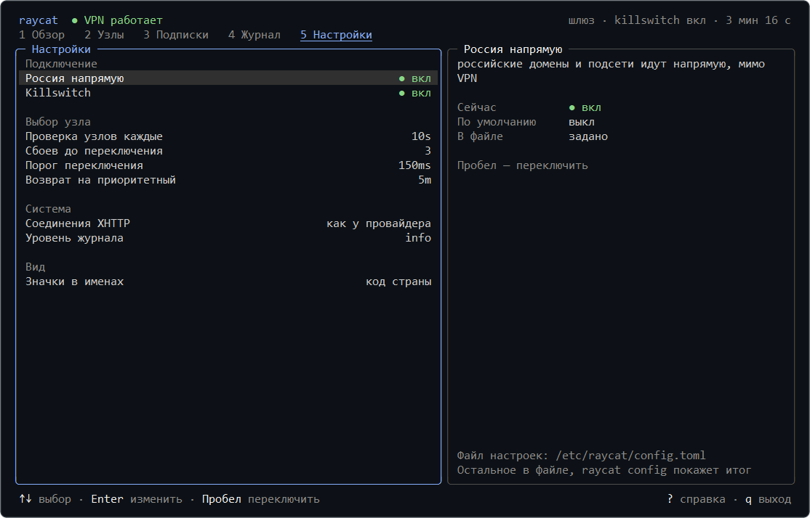

<div align="center">

<picture>
  <source media="(prefers-color-scheme: light)" srcset="assets/logo-light.svg">
  
</picture>

# raycat

**A VPN subscription manager for Linux servers**<br>
For chosen containers, the whole server or your home network.

[](https://github.com/raycat-app/raycat/releases)
[](https://github.com/raycat-app/raycat/actions/workflows/ci.yml)
[](https://www.rust-lang.org/)
[](https://github.com/raycat-app/raycat/releases)
[](https://github.com/raycat-app/raycat/pkgs/container/raycat)
[](../LICENSE)

[Installation](#installation) · [Modes](#modes) · [Managing it](#managing-it) · [Settings](#settings) · [Support](#support) · [Русский](README.md)

[Report a bug](https://github.com/raycat-app/raycat/issues/new?template=bug.yml) · [Suggest an improvement](https://github.com/raycat-app/raycat/issues/new?template=feature.yml)

<br>



</div>

<br>

raycat obtains a VPN subscription from your provider and maintains a tunnel on a Linux server. Traffic from selected containers, the whole server or devices on your home network is routed through the VPN without configuring individual applications.

The subscription is requested the same way Happ (Windows and Android) and INCY (Android) request it, so raycat also works with providers that only serve their own apps. The tunnel is built on [Xray-core](https://github.com/XTLS/Xray-core). raycat supports backup subscriptions, automatic node selection on failure, excluding nodes by mask and direct access to Russian resources. When no nodes are available, the kill switch keeps traffic from leaving outside the VPN.

> [!NOTE]
> No stable version has been released yet. Until then, use the `ghcr.io/raycat-app/raycat:dev` image and install with `--channel dev`.

## Installation

### Docker

Only containers attached to raycat are routed through the VPN. Other containers and the server itself are not affected.

`raycat/config.toml`:

```toml
[[subscription]]
url = "https://…"       # the subscription link
app = "happ"            # the app your provider accepts: happ or incy
platform = "windows"    # windows or android (android only for incy)

[mode]
type = "gateway"
```

> [!CAUTION]
> A subscription link is equivalent to a password. Do not publish it or keep it in public repositories.

`compose.yml` next to the `raycat` directory, where `app` is your application:

```yaml
services:
  raycat:
    image: ghcr.io/raycat-app/raycat
    restart: unless-stopped
    cap_add: [NET_ADMIN]
    dns: [1.1.1.1]
    volumes:
      - ./raycat:/etc/raycat
      - raycat-state:/var/lib/raycat

  app:
    image: your-application
    network_mode: service:raycat   # routes the container's traffic through the VPN
    depends_on:
      raycat:
        condition: service_healthy
        restart: true

volumes:
  raycat-state:
```

```sh
docker compose up -d
docker compose exec raycat raycat tui
```

### Service on a server

```sh
curl -fsSL https://raw.githubusercontent.com/raycat-app/raycat/main/deploy/install.sh | sudo sh
sudo raycat init --force    # asks for the link, the app and the mode
sudo systemctl start raycat
sudo raycat tui
```

<p align="right"><a href="#raycat">back to top</a></p>

## Modes

| Through the VPN | How to run | Settings |
| --- | --- | --- |
| **Selected containers** | raycat in Docker, containers with `network_mode: service:raycat` | `type = "gateway"` |
| **The whole server** | raycat as a systemd service | `type = "gateway"` |
| **Individual programs** | an HTTP and SOCKS5 proxy on `127.0.0.1:7890` | `type = "proxy"` |
| **Home network** | raycat in the host network, the server set as the gateway on devices | `type = "gateway"`, `lan = true` |

> [!IMPORTANT]
> The kill switch applies in `gateway` mode: without the tunnel, traffic and DNS queries do not leave. In `proxy` mode, programs that do not use the proxy connect directly.

Builds are available for x86_64, arm64 and armv7, including Raspberry Pi.

<p align="right"><a href="#raycat">back to top</a></p>

## Managing it

`raycat tui` shows the status, nodes, subscriptions, log and settings on one screen and supports a mouse. The main settings can be changed directly in the interface.

<div align="center">
  
</div>

<details>
<summary><b>The Settings tab</b></summary>

<br>



</details>

<br>

| Key | Tab | Actions |
| --- | --- | --- |
| <kbd>1</kbd> | Overview | tunnel status, updating subscriptions, speed test |
| <kbd>2</kbd> | Nodes | pin <kbd>p</kbd>, exclude <kbd>x</kbd>, hide unavailable <kbd>d</kbd>, speed test <kbd>t</kbd> |
| <kbd>3</kbd> | Subscriptions | masks <kbd>m</kbd> and order <kbd>[</kbd> <kbd>]</kbd> |
| <kbd>4</kbd> | Log | events, warnings only <kbd>w</kbd> |
| <kbd>5</kbd> | Settings | changing the main parameters |

The same actions are available from the command line:

| Command | Purpose |
| --- | --- |
| `raycat status` | tunnel status, current node, subscriptions |
| `raycat nodes` | list of nodes |
| `raycat use <node>`, `raycat use auto` | pin a node, return to automatic selection |
| `raycat update` | update subscriptions now |
| `raycat speedtest` | speed test through the VPN |
| `raycat check` | check the settings file |
| `raycat config` | effective settings, with secrets hidden |
| `raycat reload` | apply changes to the settings file |

Full list of commands: `raycat --help`.

<p align="right"><a href="#raycat">back to top</a></p>

## Settings

Settings are stored in one file: `/etc/raycat/config.toml` on a server or `raycat/config.toml` in the Docker example. Every parameter is explained in the [example settings](../deploy/config.example.toml). If a parameter name has a typo, raycat suggests the correct one.

> [!TIP]
> After changing the file, run `sudo raycat reload`. Parameters that can be applied without a restart take effect immediately; for the rest, raycat reports that a restart is required.

<details>
<summary><b>Routing rules</b></summary>

<br>

By default all traffic is routed through the VPN. Rules define exceptions: for example, a bank's site opens directly, while a particular Russian site goes through the VPN.

```toml
[routing]
ru_direct = true

[[routing.rule]]
domains = ["mybank.example"]
action = "direct"             # direct: bypass the VPN

[[routing.rule]]
domains = ["*.example.ru"]    # *.example.ru: the site and its subdomains
action = "proxy"              # proxy: through the VPN, block: block it
```

Rules are checked from top to bottom, and the first match applies. They take priority over `ru_direct`. Instead of `domains`, or together with them, you can set `ips`: subnets or single addresses.

</details>

<details>
<summary><b>Home network</b></summary>

<br>

raycat must run in the host's network namespace: as a service, or in Docker with `network_mode: host`.

```toml
[mode]
type = "gateway"
lan = true
```

On the device or in your router's DHCP, set the server's address as the gateway and DNS server. Enabling `ip_forward` is not required, and SSH and other host services keep working. `raycat check` shows the intercepted interface and subnets.

</details>

<details>
<summary><b>Environment variables</b></summary>

<br>

These override values from the settings file, which is convenient in Docker.

| Variable | Parameter |
| --- | --- |
| `RAYCAT_SUBSCRIPTION`, `RAYCAT_SUBSCRIPTION_FILE` | the link of the first subscription, or a file with it |
| `RAYCAT_APP`, `RAYCAT_PLATFORM` | the app and platform of the first subscription |
| `RAYCAT_MODE`, `RAYCAT_KILL_SWITCH`, `RAYCAT_LAN`, `RAYCAT_LISTEN` | the operating mode |
| `RAYCAT_PROXY_AUTH`, `RAYCAT_PROXY_AUTH_FILE` | the proxy login and password |
| `RAYCAT_SEED`, `RAYCAT_LOG` | the device and the log level |
| `RAYCAT_CONFIG`, `RAYCAT_STATE_DIR`, `RAYCAT_SOCKET` | paths |

</details>

<details>
<summary><b>Troubleshooting</b></summary>

<br>

**The provider returns no nodes.** Run `raycat fetch <subscription>` to see the provider's response. Errors 403 and 404 usually mean a different app or platform is required. The device limit may also be exhausted, or the subscription may have expired.

**`raycat status` reports that the daemon is not running.** Check `sudo systemctl status raycat` and `journalctl -u raycat -n 100`. Client commands are run with `sudo`.

**The gateway does not start in Docker.** It requires `cap_add: [NET_ADMIN]` and `dns: [1.1.1.1]`, as in the example.

**Settings from the interface are not saved in Docker.** Mount the directory, not a single file, as in the example.

**Low speed on Raspberry Pi 3 and 4.** These processors have no hardware AES acceleration. The installer selects the right build automatically; in Docker, use the tag with the `-noaes` suffix, for example `:latest-noaes`.

</details>

<details>
<summary><b>Updates and verifying builds</b></summary>

<br>

Releases are published on two channels. `dev` is built from every change, and `stable` is released automatically after a build has spent its holding period on dev. Xray-core updates and vulnerability fixes are released without a holding period. To update a server installation, run the install command again; settings are kept. To uninstall: `sudo sh install.sh --uninstall`.

Archives and images are signed with GitHub attestations:

```sh
gh attestation verify raycat-X.Y.Z-x86_64-linux-musl.tar.gz --repo raycat-app/raycat
gh attestation verify oci://ghcr.io/raycat-app/raycat:latest --repo raycat-app/raycat
```

</details>

<p align="right"><a href="#raycat">back to top</a></p>

## Roadmap

- [x] A gateway for containers, the server and the home network
- [x] Happ and INCY request formats with automatic profile updates
- [x] A terminal interface with mouse support and settings applied without a restart
- [ ] The first stable version, 0.1.0
- [ ] Version 1.0

<p align="right"><a href="#raycat">back to top</a></p>

## Support

Questions are discussed in [Discussions](https://github.com/raycat-app/raycat/discussions); report bugs in [Issues](https://github.com/raycat-app/raycat/issues). Do not publish your subscription link or the output of `raycat identity`. Report vulnerabilities [privately](https://github.com/raycat-app/raycat/security/advisories/new).

Distributed under the [MIT](../LICENSE) license.

## Built with

[](https://www.rust-lang.org/) [](https://github.com/XTLS/Xray-core) [](https://ratatui.rs/)
