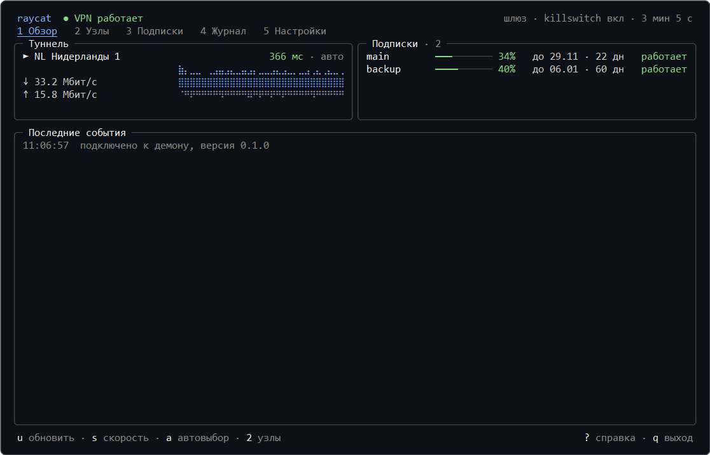
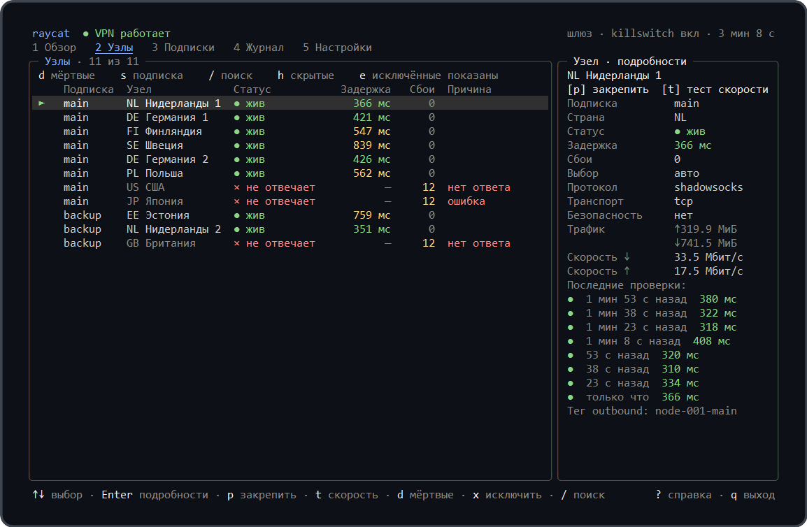
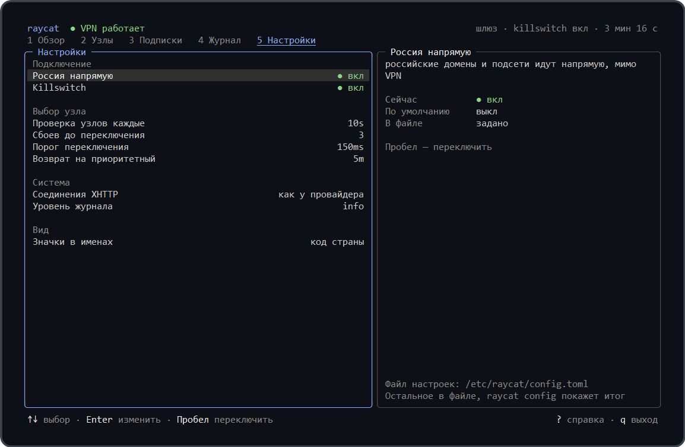

<div align="center">

<picture>
  <source media="(prefers-color-scheme: light)" srcset="assets/logo-light.svg">
  
</picture>

# raycat

**Менеджер VPN-подписок для Linux-серверов**<br>
Для нужных контейнеров, всего сервера или домашней сети.

[](https://github.com/raycat-app/raycat/releases)
[](https://www.rust-lang.org/)
[](https://github.com/raycat-app/raycat/releases)
[](https://github.com/raycat-app/raycat/pkgs/container/raycat)
[](../LICENSE)

[Установка](#установка) · [Режимы работы](#режимы-работы) · [Управление](#управление) · [Настройки](#настройки) · [Поддержка](#поддержка) · [English](README.en.md)

[Сообщить об ошибке](https://github.com/raycat-app/raycat/issues/new?template=bug.yml) · [Предложить улучшение](https://github.com/raycat-app/raycat/issues/new?template=feature.yml)

<br>



</div>

<br>

raycat получает VPN-подписку у провайдера и поддерживает туннель на Linux-сервере. Трафик выбранных контейнеров, всего сервера или устройств домашней сети направляется через VPN без настройки отдельных приложений.

Подписка запрашивается так же, как это делают Happ (Windows и Android) и INCY (Android), поэтому raycat работает и с провайдерами, которые выдают подписку только своим приложениям. Туннель строится на [Xray-core](https://github.com/XTLS/Xray-core). Поддерживаются резервные подписки, автоматический выбор узла при сбое, исключение узлов по маскам и прямой доступ к российским ресурсам. Если доступных узлов нет, killswitch блокирует трафик мимо VPN.

> [!NOTE]
> Стабильная версия ещё не выпущена. До её выхода используйте образ `ghcr.io/raycat-app/raycat:dev` и установку с параметром `--channel dev`.

## Установка

### Docker

Через VPN направляются только контейнеры, подключённые к raycat. Остальные контейнеры и сам сервер работают без изменений.

`raycat/config.toml`:

```toml
[[subscription]]
url = "https://…"       # ссылка подписки
app = "happ"            # приложение, которое принимает провайдер: happ или incy
platform = "windows"    # windows или android (для incy только android)

[mode]
type = "gateway"
```

> [!CAUTION]
> Ссылка подписки равнозначна паролю. Не публикуйте её и не храните в открытых репозиториях.

`compose.yml` рядом с каталогом `raycat`, где `app` — ваше приложение:

```yaml
services:
  raycat:
    image: ghcr.io/raycat-app/raycat
    restart: unless-stopped
    cap_add: [NET_ADMIN]
    dns: [1.1.1.1]
    volumes:
      - ./raycat:/etc/raycat
      - raycat-state:/var/lib/raycat

  app:
    image: ваше-приложение
    network_mode: service:raycat   # направляет трафик контейнера через VPN
    depends_on:
      raycat:
        condition: service_healthy
        restart: true

volumes:
  raycat-state:
```

```sh
docker compose up -d
docker compose exec raycat raycat tui
```

### Служба на сервере

```sh
curl -fsSL https://raw.githubusercontent.com/raycat-app/raycat/main/deploy/install.sh | sudo sh
sudo raycat init --force    # запрос ссылки, приложения и режима
sudo systemctl start raycat
sudo raycat tui
```

<p align="right"><a href="#raycat">наверх</a></p>

## Режимы работы

| Через VPN | Способ запуска | Параметры |
| --- | --- | --- |
| **Выбранные контейнеры** | raycat в Docker, у контейнеров `network_mode: service:raycat` | `type = "gateway"` |
| **Весь сервер** | raycat как служба systemd | `type = "gateway"` |
| **Отдельные программы** | прокси HTTP и SOCKS5 на `127.0.0.1:7890` | `type = "proxy"` |
| **Домашняя сеть** | raycat в сети хоста, сервер указан шлюзом на устройствах | `type = "gateway"`, `lan = true` |

> [!IMPORTANT]
> Killswitch действует в режиме `gateway`: без туннеля трафик и DNS-запросы не выходят наружу. В режиме `proxy` программы, не использующие прокси, обращаются в сеть напрямую.

Сборки доступны для x86_64, arm64 и armv7, включая Raspberry Pi.

<p align="right"><a href="#raycat">наверх</a></p>

## Управление

`raycat tui` выводит состояние, узлы, подписки, журнал и настройки на одном экране и поддерживает мышь. Основные настройки изменяются прямо в интерфейсе.

<p align="center">
  
  
</p>

Основные действия доступны и в интерфейсе, и из командной строки:

| Действие | В `raycat tui` | Команда |
| --- | --- | --- |
| Состояние туннеля и подписок | вкладка <kbd>1</kbd> | `raycat status` |
| Список узлов | вкладка <kbd>2</kbd> | `raycat nodes` |
| Закрепить узел | <kbd>p</kbd> | `raycat use <узел>` |
| Вернуть автоматический выбор | <kbd>a</kbd> | `raycat use auto` |
| Обновить подписки | <kbd>u</kbd> | `raycat update` |
| Проверить скорость | <kbd>s</kbd>, для выбранного узла <kbd>t</kbd> | `raycat speedtest` |
| Исключить узел из автовыбора | <kbd>x</kbd> | маска `deny` в файле настроек |
| Изменить настройки | вкладка <kbd>5</kbd> | файл настроек и `raycat reload` |
| Проверить файл настроек | — | `raycat check` |

Остальные клавиши показывает <kbd>?</kbd> в интерфейсе, остальные команды — `raycat --help`.

<p align="right"><a href="#raycat">наверх</a></p>

## Настройки

Настройки хранятся в одном файле: `/etc/raycat/config.toml` на сервере или `raycat/config.toml` в примере с Docker. Все параметры с пояснениями приведены в [примере настроек](../deploy/config.example.toml). При опечатке в названии параметра raycat предлагает правильный вариант.

> [!TIP]
> После изменения файла выполните `sudo raycat reload`. Параметры, которые можно применить без перезапуска, вступят в силу сразу; для остальных будет указано, что требуется перезапуск.

<details>
<summary><b>Правила маршрутизации</b></summary>

<br>

По умолчанию весь трафик направляется через VPN. Правила задают исключения: например, сайт банка открывается напрямую, а отдельный российский сайт, наоборот, через VPN.

```toml
[routing]
ru_direct = true

[[routing.rule]]
domains = ["mybank.example"]
action = "direct"             # direct: в обход VPN

[[routing.rule]]
domains = ["*.example.ru"]    # *.example.ru: сайт и его поддомены
action = "proxy"              # proxy: через VPN, block: блокировать
```

Правила проверяются сверху вниз, применяется первое подходящее. Они имеют приоритет над `ru_direct`. Вместо `domains` или вместе с ними можно указать `ips`: подсети или отдельные адреса.

</details>

<details>
<summary><b>Домашняя сеть</b></summary>

<br>

raycat должен работать в сетевом пространстве хоста: как служба или в Docker с `network_mode: host`.

```toml
[mode]
type = "gateway"
lan = true
```

На устройстве или в DHCP маршрутизатора укажите адрес сервера в качестве шлюза и DNS-сервера. Включать `ip_forward` не требуется, SSH и другие службы хоста продолжают работать. `raycat check` показывает перехватываемый интерфейс и подсети.

</details>

<details>
<summary><b>Переменные окружения</b></summary>

<br>

Переопределяют значения из файла настроек, что удобно в Docker.

| Переменная | Параметр |
| --- | --- |
| `RAYCAT_SUBSCRIPTION`, `RAYCAT_SUBSCRIPTION_FILE` | ссылка первой подписки или файл с ней |
| `RAYCAT_APP`, `RAYCAT_PLATFORM` | приложение и платформа первой подписки |
| `RAYCAT_MODE`, `RAYCAT_KILL_SWITCH`, `RAYCAT_LAN`, `RAYCAT_LISTEN` | режим работы |
| `RAYCAT_PROXY_AUTH`, `RAYCAT_PROXY_AUTH_FILE` | логин и пароль прокси |
| `RAYCAT_SEED`, `RAYCAT_LOG` | устройство и уровень журнала |
| `RAYCAT_CONFIG`, `RAYCAT_STATE_DIR`, `RAYCAT_SOCKET` | пути |

</details>

<details>
<summary><b>Устранение неполадок</b></summary>

<br>

**Провайдер не выдаёт узлы.** Выполните `raycat fetch <подписка>`: команда покажет ответ провайдера. Ошибки 403 и 404 обычно означают, что требуется другое приложение или платформа. Также возможны исчерпанный лимит устройств или истёкший срок подписки.

**`raycat status` сообщает, что демон не запущен.** Проверьте `sudo systemctl status raycat` и `journalctl -u raycat -n 100`. Клиентские команды выполняются через `sudo`.

**Шлюз в Docker не запускается.** Требуются `cap_add: [NET_ADMIN]` и `dns: [1.1.1.1]`, как в примере.

**Настройки из интерфейса не сохраняются в Docker.** Монтируйте каталог, а не отдельный файл, как в примере.

**Низкая скорость на Raspberry Pi 3 и 4.** Эти процессоры не поддерживают аппаратное ускорение AES. Установщик выбирает подходящую сборку автоматически; в Docker используйте тег с суффиксом `-noaes`, например `:latest-noaes`.

</details>

<details>
<summary><b>Обновления и проверка сборок</b></summary>

<br>

Выпуски выходят по двум каналам. `dev` собирается из каждого изменения, `stable` выпускается автоматически после выдержки сборки на канале dev. Обновления Xray-core и исправления уязвимостей выпускаются без выдержки. Для обновления установки на сервере повторите команду установки, настройки сохраняются. Удаление: `sudo sh install.sh --uninstall`.

Архивы и образы подписаны аттестациями GitHub:

```sh
gh attestation verify raycat-X.Y.Z-x86_64-linux-musl.tar.gz --repo raycat-app/raycat
gh attestation verify oci://ghcr.io/raycat-app/raycat:latest --repo raycat-app/raycat
```

</details>

<p align="right"><a href="#raycat">наверх</a></p>

## Поддержка

Вопросы обсуждаются в [Discussions](https://github.com/raycat-app/raycat/discussions), об ошибках сообщайте в [Issues](https://github.com/raycat-app/raycat/issues). Не публикуйте ссылку подписки и вывод `raycat identity`. Об уязвимостях сообщайте [приватно](https://github.com/raycat-app/raycat/security/advisories/new).

Распространяется по лицензии [MIT](../LICENSE).

## Основано на

[](https://www.rust-lang.org/) [](https://github.com/XTLS/Xray-core) [](https://ratatui.rs/)
