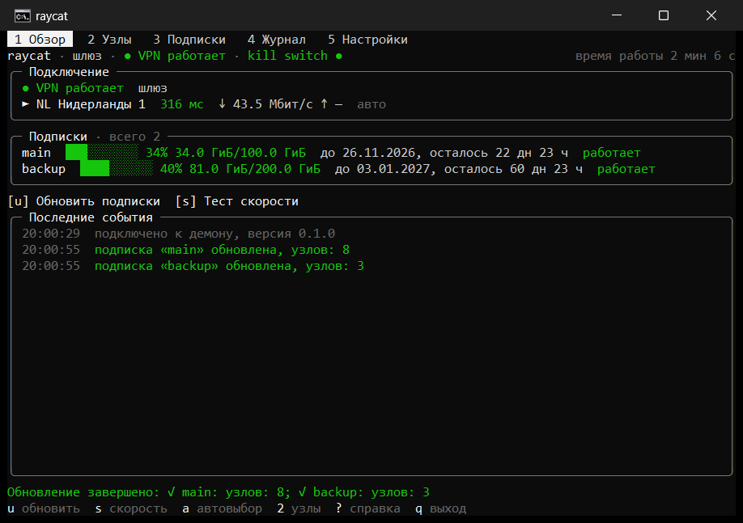
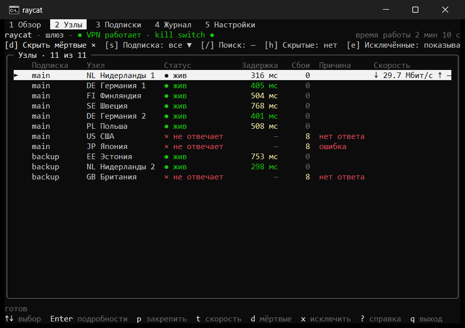

<div align="center">

<picture>
  <source media="(prefers-color-scheme: dark)" srcset="assets/logo-dark.png">
  
</picture>

# raycat

VPN-подписка для Linux-сервера: контейнеры, весь сервер или домашняя сеть выходят в интернет через неё

[](https://github.com/raycat-app/raycat/releases)
[](LICENSE)

Русский · [English](README.en.md)

</div>

<p align="center">
  
</p>

Вы даёте raycat ссылку на подписку, и он держит туннель на сервере. Настраивать сами приложения не нужно. Если узел умер, raycat переключится на живой. Если живых не осталось, трафик не уйдёт мимо VPN.

Многие провайдеры отдают подписку только своим приложениям. raycat запрашивает её так же, как Happ (Windows и Android) или INCY (Android), а туннель строит на [xray-core](https://github.com/XTLS/Xray-core).

> [!NOTE]
> Стабильной версии пока нет. До её выхода используйте образ `ghcr.io/raycat-app/raycat:dev` и установку с `--channel dev`.

## Запуск

### В Docker

Контейнер `app` здесь ваше приложение: весь его трафик пойдёт через VPN.

`raycat/config.toml`:

```toml
[[subscription]]
url = "https://…"       # ссылка подписки, никому её не показывайте
app = "happ"            # какое приложение принимает провайдер: happ или incy
platform = "windows"    # windows или android (у incy только android)

[mode]
type = "gateway"
```

`compose.yml` рядом с каталогом `raycat`:

```yaml
services:
  raycat:
    image: ghcr.io/raycat-app/raycat
    restart: unless-stopped
    cap_add: [NET_ADMIN]
    dns: [1.1.1.1]
    volumes:
      - ./raycat:/etc/raycat
      - raycat-state:/var/lib/raycat

  app:
    image: ваше-приложение
    network_mode: service:raycat
    depends_on:
      raycat:
        condition: service_healthy
        restart: true

volumes:
  raycat-state:
```

```sh
docker compose up -d
docker compose exec raycat raycat tui
```

### На сервере

```sh
curl -fsSL https://raw.githubusercontent.com/raycat-app/raycat/main/deploy/install.sh | sudo sh
sudo raycat init --force    # спросит ссылку, приложение и режим
sudo systemctl start raycat
sudo raycat tui
```

Режим `proxy` оставляет остальной трафик сервера как есть и открывает прокси HTTP и SOCKS5 на `127.0.0.1:7890`. Режим `gateway` пускает через VPN весь сервер.

## Что умеет

- **Несколько подписок.** Основная и резервные, порядок и приоритет настраиваются.
- **Выбор узла.** Проверяет узлы сам, переключается при сбое, узел можно закрепить или исключить масками вроде `Обход*`.
- **Шлюз для домашней сети.** Телевизор или приставка выходят через сервер, если указать его шлюзом.
- **Россия напрямую.** С `ru_direct = true` российские сайты идут мимо VPN.
- **Kill switch.** В режиме шлюза без туннеля трафик не выходит наружу, и DNS тоже.
- **Лёгкий.** Статические сборки для x86_64, arm64 и armv7, работает даже на Raspberry Pi.

## Управление

`raycat tui` показывает всё на одном экране и работает с мышью: состояние, узлы, подписки, журнал и настройки. Настройки можно менять прямо там.

<p align="center">
  
</p>

То же самое есть в командах:

| Команда | Что делает |
| --- | --- |
| `raycat status` | состояние туннеля, текущий узел, подписки |
| `raycat nodes` | список узлов |
| `raycat use <узел>`, `raycat use auto` | закрепить узел, вернуть автовыбор |
| `raycat update` | обновить подписки сейчас |
| `raycat speedtest` | проверить скорость через VPN |
| `raycat check` | проверить файл настроек |
| `raycat config` | показать итоговые настройки, секреты скрыты |
| `raycat reload` | применить правку файла настроек |

Остальное покажет `raycat --help`.

## Настройки

Настройки лежат в одном файле: `/etc/raycat/config.toml` на сервере, `raycat/config.toml` в примере с Docker. Все ключи с пояснениями есть в [примере настроек](deploy/config.example.toml), при опечатке raycat подскажет правильное название.

После правки выполните `sudo raycat reload`. Демон применит то, что можно применить на лету, а про остальное скажет, что нужен перезапуск.

<details>
<summary>Домашняя сеть</summary>

raycat должен работать в сети самого хоста: как служба или в Docker с `network_mode: host`.

```toml
[mode]
type = "gateway"
lan = true
```

На устройстве или в DHCP роутера укажите адрес сервера как шлюз и DNS. Включать `ip_forward` не нужно, SSH и другие службы хоста продолжат работать. `raycat check` покажет, какой интерфейс и какие подсети будут перехватываться.

</details>

<details>
<summary>Переменные окружения</summary>

Перекрывают файл настроек, удобно в Docker.

| Переменная | Что задаёт |
| --- | --- |
| `RAYCAT_SUBSCRIPTION`, `RAYCAT_SUBSCRIPTION_FILE` | ссылку первой подписки или файл с ней |
| `RAYCAT_APP`, `RAYCAT_PLATFORM` | приложение и платформу первой подписки |
| `RAYCAT_MODE`, `RAYCAT_KILL_SWITCH`, `RAYCAT_LAN`, `RAYCAT_LISTEN` | режим работы |
| `RAYCAT_PROXY_AUTH`, `RAYCAT_PROXY_AUTH_FILE` | логин и пароль прокси |
| `RAYCAT_SEED`, `RAYCAT_LOG` | устройство и уровень журнала |
| `RAYCAT_CONFIG`, `RAYCAT_STATE_DIR`, `RAYCAT_SOCKET` | пути |

</details>

<details>
<summary>Если что-то не работает</summary>

**Провайдер не отдаёт узлы.** Запустите `raycat fetch <подписка>`: команда покажет ответ провайдера. Ошибки 403 и 404 обычно значат, что нужно другое приложение или платформа. Ещё бывает, что исчерпан лимит устройств или закончился срок подписки.

**`raycat status` пишет, что демон не запущен.** Посмотрите `sudo systemctl status raycat` и `journalctl -u raycat -n 100`. Клиентские команды нужно запускать через `sudo`.

**Шлюз в Docker не стартует.** Нужны `cap_add: [NET_ADMIN]` и `dns: [1.1.1.1]`, как в примере.

**Настройки из TUI не сохраняются в Docker.** Монтируйте каталог, а не отдельный файл, как в примере.

**Медленно на Raspberry Pi 3 и 4.** У этих процессоров нет аппаратного AES. Установщик сам ставит подходящую сборку, а в Docker добавьте к тегу `-noaes`, например `:latest-noaes`.

</details>

<details>
<summary>Обновления и проверка сборок</summary>

Есть два канала. `dev` собирается из каждого изменения. `stable` выходит сам, когда сборка выдержала срок на dev. Обновления xray и исправления уязвимостей выходят сразу. Обновить установку на сервере можно той же командой установки, настройки сохранятся. Удалить: `sudo sh install.sh --uninstall`.

Архивы и образы подписаны аттестациями GitHub:

```sh
gh attestation verify raycat-X.Y.Z-x86_64-linux-musl.tar.gz --repo raycat-app/raycat
gh attestation verify oci://ghcr.io/raycat-app/raycat:latest --repo raycat-app/raycat
```

</details>

## Вопросы и ошибки

Вопросы задавайте в [обсуждениях](https://github.com/raycat-app/raycat/discussions), ошибки присылайте в [issues](https://github.com/raycat-app/raycat/issues). Никогда не публикуйте ссылку подписки и вывод `raycat identity`. Об уязвимостях сообщайте [приватно](https://github.com/raycat-app/raycat/security/advisories/new).

Лицензия [MIT](LICENSE).
